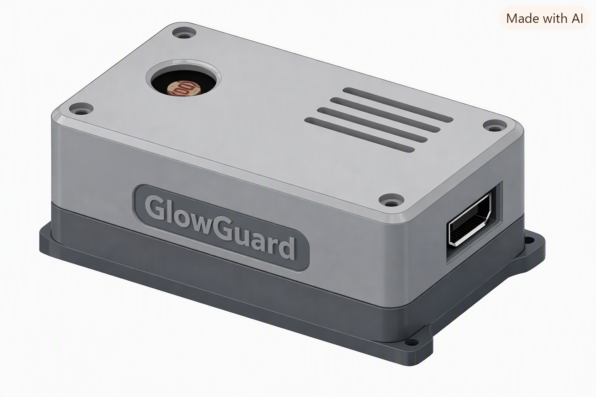
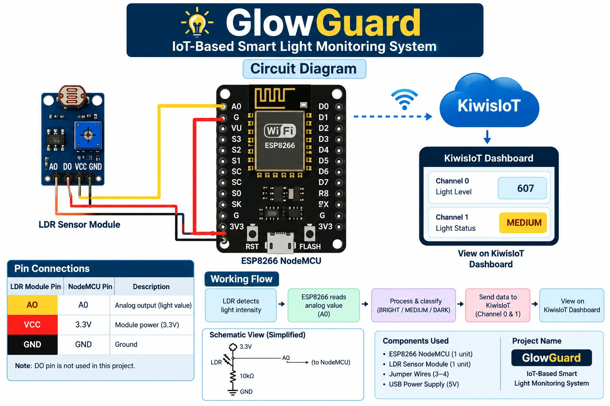
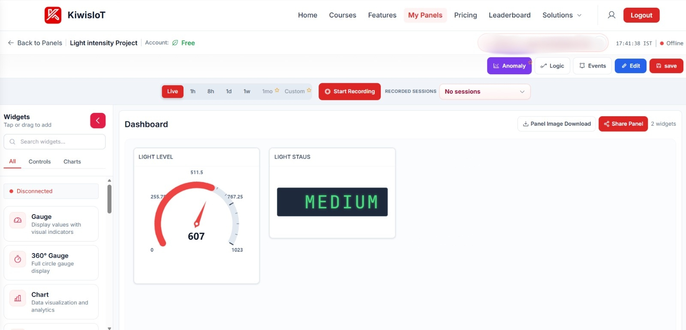
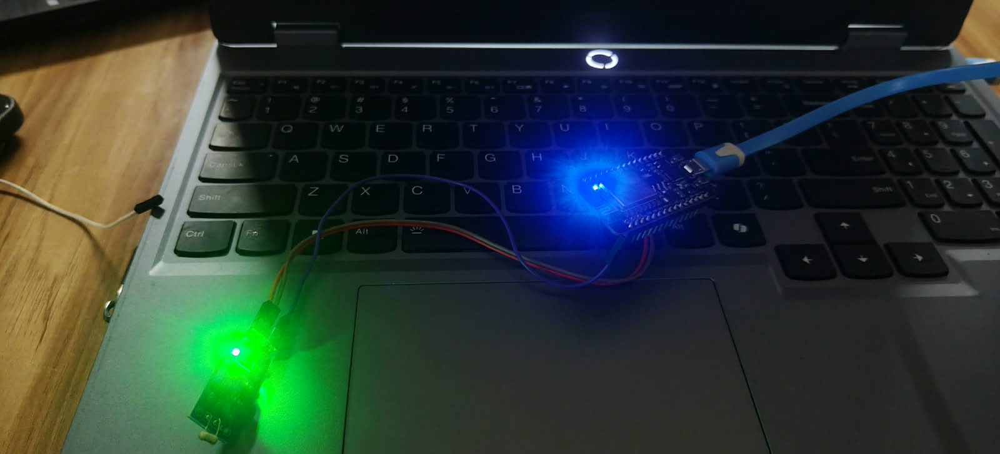

# 💡 GlowGuard – KiwisIoT Smart Light Monitoring System


**GlowGuard** is an IoT-based smart light monitoring system built with an **ESP8266 NodeMCU** and an **LDR (Light Dependent Resistor) sensor module**. It measures ambient light intensity, classifies it as **BRIGHT**, **MEDIUM**, or **DARK**, and streams the data in real time to a **KiwisIoT** cloud dashboard.

> **Project ID:** KIWISIOT-001

<p align="center">
  
</p>

---

## 📑 Table of Contents

- [Project Overview](#-project-overview)
- [Why This Project?](#-why-this-project)
- [What You'll Learn](#-what-youll-learn)
- [Components Required](#-components-required)
- [Software Requirements](#-software-requirements)
- [Circuit Connection](#-circuit-connection)
- [How the LDR Sensor Works](#-how-the-ldr-sensor-works)
- [Light Status Classification](#-light-status-classification)
- [KiwisIoT Dashboard](#-kiwisiot-dashboard)
- [Arduino Code](#-arduino-code)
- [Getting Started](#-getting-started)
- [Testing the Project](#-testing-the-project)
- [Security](#-security)
- [Repository Structure](#-repository-structure)
- [Future Improvements](#-future-improvements)
- [References](#-references)
- [License](#-license)

---

## 📖 Project Overview

GlowGuard continuously reads the analog output of an LDR sensor module connected to the ESP8266's `A0` pin. Every 2 seconds, the firmware:

1. Reads the raw analog value (0–1023)
2. Converts it into an intuitive **light level** (higher = brighter)
3. Classifies the level as **BRIGHT**, **MEDIUM**, or **DARK**
4. Sends both values to the **KiwisIoT** dashboard over Wi-Fi

### Working Flow

```
LDR detects light  →  ESP8266 reads analog (A0)  →  Process & classify
                                                          │
        View on KiwisIoT Dashboard  ←  Send to KiwisIoT (Channel 0 & 1)
```

---

## 🎯 Why This Project?

- Monitor lighting conditions in rooms, labs, classrooms, or greenhouses remotely
- Detect day/night conditions for smart-lighting and automation ideas
- A beginner-friendly project that introduces sensors, microcontrollers, and cloud dashboards in one build
- Low cost, simple wiring, and quick to set up

---

## 🧠 What You'll Learn

- Interfacing an LDR sensor module with an ESP8266 NodeMCU
- Reading analog values using `analogRead()`
- Mapping and classifying sensor data with threshold logic
- Connecting an ESP8266 to Wi-Fi and a cloud IoT platform
- Building a live dashboard with gauge and status widgets on KiwisIoT

---

## 🧰 Components Required

| Component | Quantity |
|-----------|----------|
| ESP8266 NodeMCU | 1 |
| LDR Sensor Module | 1 |
| Jumper Wires | 3–4 |
| USB Cable / 5V USB Power Supply | 1 |

---

## 💻 Software Requirements

- [Arduino IDE](https://www.arduino.cc/en/software)
- ESP8266 board package for Arduino IDE
- **KiwisIoT** Arduino library
- A free [KiwisIoT](https://kiwisiot.com) account (for the dashboard and topic ID)

---

## 🔌 Circuit Connection

<p align="center">
  
</p>

| LDR Module Pin | NodeMCU Pin | Description |
|----------------|-------------|-------------|
| `AO` | `A0` | Analog output (light value) |
| `VCC` | `3.3V` | Module power (3.3V) |
| `GND` | `GND` | Ground |

> **Note:** The `DO` (digital output) pin is **not used** in this project.

---

## 🔦 How the LDR Sensor Works

An LDR (Light Dependent Resistor) changes its resistance based on the light falling on it:

- **More light** → lower resistance
- **Less light** → higher resistance

The sensor module uses the LDR in a voltage-divider arrangement and outputs an analog voltage on `AO`. The ESP8266's ADC reads this as a value from **0 to 1023**.

On this module, the raw reading is **higher in darkness and lower in brightness**. To make the dashboard intuitive, the code inverts it:

```cpp
int lightLevel = 1023 - rawValue;   // Higher value = brighter light
```

---

## 🚦 Light Status Classification

| Light Level | Status |
|-------------|--------|
| `>= 700` | 🟡 **BRIGHT** |
| `300 – 699` | 🟠 **MEDIUM** |
| `< 300` | 🔵 **DARK** |

You can tune these thresholds in the code to suit your environment and sensor module (adjust the on-board potentiometer if needed).

---

## 📊 KiwisIoT Dashboard

<p align="center">
  
</p>

### Dashboard Configuration

| Channel | Data | Widget | Example |
|---------|------|--------|---------|
| `0` | Light Level (0–1023) | Gauge | `607` |
| `1` | Light Status | Text / Display | `MEDIUM` |

**Steps:**

1. Log in to KiwisIoT and open **My Panels** → create a new panel (e.g., *Light intensity Project*).
2. Add a **Gauge** widget → bind to **Channel 0**, range `0 – 1023`.
3. Add a **Text/Display** widget → bind to **Channel 1**.
4. Copy your dashboard **Topic ID** and paste it into the Arduino code.
5. Save the panel and watch live data arrive.

---

## 👨‍💻 Arduino Code

The complete sketch is available in [`GlowGuard/GlowGuard.ino`](GlowGuard/GlowGuard.ino).

```cpp
/*
 * Project: LDR Light Sensor Module with ESP8266 and KiwisIoT
 * Project ID: KIWISIOT-001
 * Board: ESP8266 NodeMCU
 * Sensor: LDR Sensor Module
 */

#include <ESP8266WiFi.h>
#include <KiwisIoT.h>

const char* ssid = "YOUR_WIFI_NAME";
const char* pass = "YOUR_WIFI_PASSWORD";

const char* topic = "YOUR_DASHBOARD_TOPIC_ID";

#define LDR_PIN A0

KiwisIoT kiwisiot(ssid, pass, topic);

void sendLightData() {

  int rawValue = analogRead(LDR_PIN);

  int lightLevel = 1023 - rawValue;

  String lightStatus;

  if (lightLevel >= 700) {
    lightStatus = "BRIGHT";
  }
  else if (lightLevel >= 300) {
    lightStatus = "MEDIUM";
  }
  else {
    lightStatus = "DARK";
  }

  Serial.println();
  Serial.println("---------- LIGHT MONITORING ----------");

  Serial.print("Raw LDR Value: ");
  Serial.println(rawValue);

  Serial.print("Light Level: ");
  Serial.println(lightLevel);

  Serial.print("Light Status: ");
  Serial.println(lightStatus);

  kiwisiot.send("0", String(lightLevel));

  kiwisiot.send("1", lightStatus);

  Serial.print("Sent to KiwisIoT Channel 0: ");
  Serial.println(lightLevel);

  Serial.print("Sent to KiwisIoT Channel 1: ");
  Serial.println(lightStatus);
}

void setup() {

  Serial.begin(115200);

  Serial.println();
  Serial.println("    LDR LIGHT MONITORING    ");

  pinMode(LDR_PIN, INPUT);

  Serial.println("LDR initialized");

  Serial.println("Connecting to KiwisIoT...");

  kiwisiot.begin();

  Serial.println("KiwisIoT initialized");
  Serial.println("Starting light monitoring...");
}

void loop() {

  kiwisiot.run();

  static unsigned long lastSend = 0;

  if (millis() - lastSend >= 2000) {

    lastSend = millis();

    sendLightData();
  }

  delay(100);
}
```

---

## 🚀 Getting Started

1. **Clone the repository**
   ```bash
   git clone https://github.com/<your-username>/GlowGuard-KiwisIoT-Smart-Light-Monitoring-System.git
   cd GlowGuard-KiwisIoT-Smart-Light-Monitoring-System
   ```
2. **Install** the Arduino IDE, the ESP8266 board package, and the KiwisIoT library.
3. **Wire** the LDR module to the NodeMCU as shown in [Circuit Connection](#-circuit-connection).
4. **Open** `GlowGuard/GlowGuard.ino` in the Arduino IDE.
5. **Update** `ssid`, `pass`, and `topic` with your own Wi-Fi and KiwisIoT details.
6. **Select** the board (*NodeMCU 1.0 (ESP-12E Module)*) and the correct COM port.
7. **Upload** the sketch and open the Serial Monitor at **115200 baud**.
8. **Open** your KiwisIoT dashboard to view live data.

---

## ✅ Testing the Project

<p align="center">
  
</p>

1. Power the NodeMCU via USB.
2. Open the Serial Monitor (115200 baud) and confirm Wi-Fi/KiwisIoT connection.
3. Cover the sensor with your hand → value drops, status changes to **DARK**.
4. Shine a torch or phone light on it → value rises, status changes to **BRIGHT**.
5. Confirm the **Gauge** and **Status** widgets update on the KiwisIoT dashboard.

**Sample Serial Output**

```
---------- LIGHT MONITORING ----------
Raw LDR Value: 416
Light Level: 607
Light Status: MEDIUM
Sent to KiwisIoT Channel 0: 607
Sent to KiwisIoT Channel 1: MEDIUM
```

---

## 🔒 Security

- **Never commit real credentials.** Keep `YOUR_WIFI_NAME`, `YOUR_WIFI_PASSWORD`, and `YOUR_DASHBOARD_TOPIC_ID` as placeholders in the repository.
- Consider storing secrets in a separate `secrets.h` file and adding it to `.gitignore`:
  ```cpp
  // secrets.h  (do NOT commit)
  #define WIFI_SSID  "your-wifi-name"
  #define WIFI_PASS  "your-wifi-password"
  #define TOPIC_ID   "your-topic-id"
  ```
- Use a trusted/private Wi-Fi network, and rotate your KiwisIoT topic ID if you suspect it has been exposed.
- Share your dashboard publicly only if you are comfortable with the data being visible.

---

## 📁 Repository Structure

```
GlowGuard-KiwisIoT-Smart-Light-Monitoring-System/
├── GlowGuard/
│   └── GlowGuard.ino
├── images/
│   ├── GlowGuard_CAD.png
│   ├── circuit_diagram.jpeg
│   ├── kiwisIoT_output.jpeg
│   └── real_time_image.jpeg
├── .gitignore
├── LICENSE
└── README.md
```

---

## 🔮 Future Improvements

- Automatic light/relay control based on light status
- Threshold alerts and notifications through KiwisIoT events
- Data logging and historical charts
- 3D-printed enclosure based on the GlowGuard CAD design
- Battery-powered, low-power deep-sleep version

---

## 📚 References

- [KiwisIoT Platform](https://kiwisiot.com)
- [ESP8266 Arduino Core Documentation](https://arduino-esp8266.readthedocs.io/)
- [Arduino `analogRead()` Reference](https://www.arduino.cc/reference/en/language/functions/analog-io/analogread/)

---

## 📄 License

This project is released under the **LGPL** license. See the [LICENSE](LICENSE) file for details.

---

<p align="center">Made with ❤️ using ESP8266 and KiwisIoT</p>
